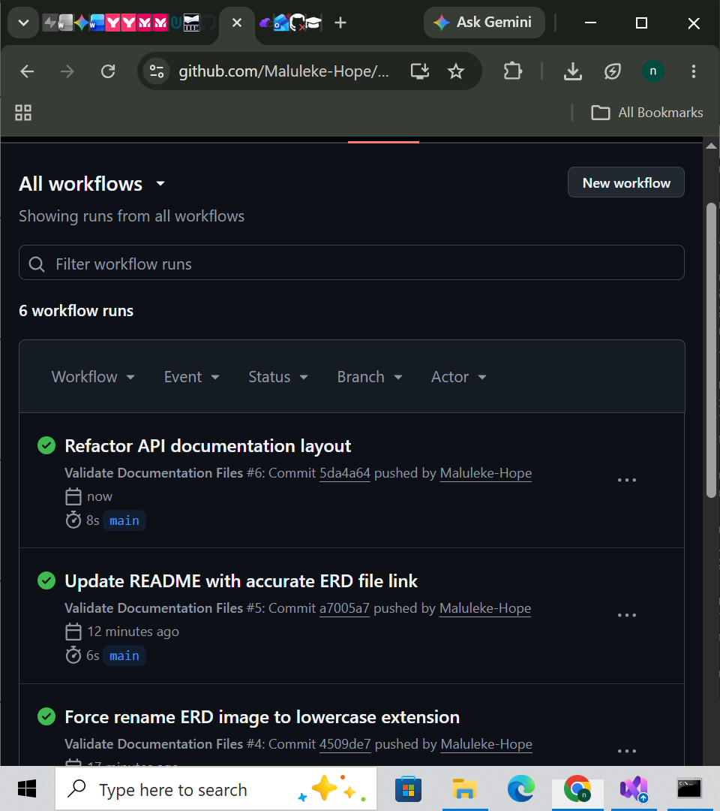

# RaceDay - Event Management System (PROG6212 POE Part 1)

[](https://github.com/Maluleke-Hope/prog6212-poe-RaceDay/actions)

Overview
RaceDay is a full-stack database-driven system designed for managing South African road running, walking, and cycling events.

System Roles
- Organiser: Creates and manages events, sets up distance categories, and logs participant finish results.
- Participant: Registers for available events, receives designated bib numbers, and views historical performance.

Included Documentation
- `/docs/RaceDay_ERD.png` : ERD detailing entities, primary/foreign keys, and cardinalities.
- `/docs/API_Endpoint_Plan.md` : Complete RESTful API specification table including routes, HTTP methods, roles, payloads, and response status codes.
- `/docs/RaceDay_Database.sql` : Production T-SQL database creation script with table constraints, foreign key cascades, and seed data.
- `/docs/CI_Pass_Screenshot.png` : Verification screenshot of the passing GitHub Actions CI pipeline.

Automated Testing & CI Status


Demonstration Video

https://youtu.be/PNqA6RTLNG8

AI Assistance & Prompt Declaration

In accordance with academic integrity guidelines, Generative AI (Gemini / ChatGPT) was used strictly as an peer assistant and debugging tool during the development of Part 1. 

Scope of AI Usage
AI was used for:
1. Syntax troubleshooting during T-SQL script execution in SSMS.
2. Formatting and structuring the RESTful API Endpoint Plan table in Markdown.
3. Reviewing documentation against the assessment rubric for completeness.

All underlying database schema designs, primary/foreign key relationships, business logic rules, repository configurations, and presentation video demonstrations were designed, implemented, and verified independently.

### Representative Prompts Used
Below are examples of the specific prompts issued during development:

Database Script Debugging:
 
 >I am getting 'Msg 208: Invalid object name' when running my T-SQL script in SSMS. How do I ensure my script automatically creates and targets the correct database instance before building tables?

PI Documentation Alignment:

  > How should I structure a RESTful API endpoint specification table in Markdown to clearly map HTTP verbs, routes, request bodies, and standard HTTP response status codes for an ASP.NET Core Web API?

Rubric & Quality Check:

  > What are the standard technical documentation requirements for an ERD, API plan, and database script for a C# and SQL event management system submission?

  # RaceDay Event Management System - Part 3 (MVC Web App)

## Overview
RaceDay is a full-stack web application built for the PROG6212 POE. It is designed for the South African road running, walking, and cycling community to manage and enrol in events.

This repository contains the complete solution across all three parts:
*   **Part 1:** System Planning and Database (ERD, API Plan, SQL Script).
*   **Part 2:** RESTful API built with ASP.NET Core 10 and Entity Framework Core.
*   **Part 3:** MVC Web Application consuming the API, implementing session management, role-based interfaces, Azure Blob Storage (via Azurite), and CI/CD.

## Key Features
*   **Authentication:** Secure cookie-based authentication with BCrypt password hashing.
*   **Role-Based Access Control (RBAC):** Distinct interfaces and permissions for Organisers and Participants.
*   **Event Management:** Full CRUD (Create, Read, Update, Delete) for events.
*   **Resource Ownership:** Organisers can only edit/delete their own events.
*   **Enrolments:** Participants can enrol and cancel their enrolments.
*   **Azure Blob Storage:** Organisers can upload event banner images. The API handles the upload to Azure Blob Storage (simulated locally via the Azurite emulator).
*   **Validation:** Date validation to prevent scheduling events in the past.
*   **CI/CD:** Automated GitHub Actions pipeline for builds.

## Setup Instructions
1.  **Clone the repository:**
    ```bash
    git clone https://github.com/Maluleke-Hope/prog6212-poe-RaceDay.git
Open the solution:
Open PROG6212_RaceDay.slnx in Visual Studio 2026.

Database Setup:

Ensure your SQL Server is running.

Open the Package Manager Console and run Update-Database (or run the provided SQL script in the /docs folder).

Azure Storage Emulator (Azurite):

Install Azurite globally: npm install -g azurite

Start the emulator in a new terminal: azurite --silent --location c:\azurite

Run the Application:

Set both RaceDay.API and RaceDay.Web as startup projects.

Press F5 to run.

Demonstration Users
Organiser: sipho@raceday.co.za / Password123!

Participant: david@gmail.com / Password123!

Automated Testing & CI Status
The project uses GitHub Actions to automatically build and verify the solution on every push to the main branch. All workflows are passing successfully.

https://github.com/Maluleke-Hope/prog6212-poe-RaceDay/actions/workflows/dotnet.yml/badge.svg

(You can also view the live status on the Actions tab).

Demonstration Video
Watch the RaceDay Part 3 Video Presentation on YouTube
https://www.youtube.com/watch?v=0Yez4_FyoLM

AI Assistance & Prompt Declaration
In accordance with academic integrity guidelines, Generative AI was used strictly as a peer assistant and debugging tool during the development of this POE.

Scope of AI Usage:

Troubleshooting Entity Framework Core migrations and database seeding errors.

Debugging Razor View syntax and JSON deserialization in the MVC Web App.

Assisting with the configuration of the Azurite emulator for local Azure Blob Storage testing.

Formatting and structuring documentation and README files.

All underlying system architecture, database schema design, API implementation, and business logic were reviewed, understood, and verified independently.
